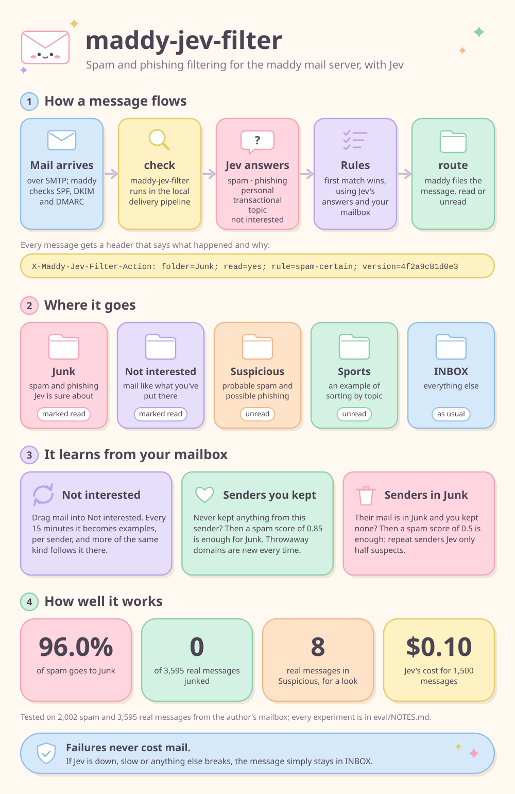

# maddy-jev-filter

Sorts incoming mail for [maddy](https://maddy.email) into IMAP folders with
[Jev](https://docs.typesafe.ai), TypeSafe's classifier model. Jev answers a
few questions about each message, such as "is this spam?" and "is this
phishing?", and rules in a config file turn the answers into a folder.



With the example config:

- Spam and phishing Jev is sure about go to **Junk**, marked as read.
- Mail like what you've put in **Not interested** goes there, marked as read.
- Probable spam and possible phishing go to **Suspicious**, unread, for you
  to check.
- Mail about sports goes to **Sports**, unread, as an example of sorting by
  topic.
- Everything else stays in INBOX.

The filter also learns from your mailbox. Mail from a sender you've never
kept anything from needs a lower spam score to be junked, and mail from a
sender whose mail you moved to Junk needs an even lower one.

## How well it works

On a sample of about 2,000 spam messages and 3,600 real ones:

| | Junk | Suspicious | INBOX |
|---|---|---|---|
| Spam | 96.0% | 0.6% | 3.4% |
| Real mail | 0 | 8 | 3,587 |

The example config leans towards leaving spam in INBOX over junking real
mail.
[eval/NOTES.md](eval/NOTES.md) has every experiment so far, with its results
and costs. A run over 1,500 messages costs about $0.10.

## How it works

maddy runs the filter twice for each message:

1. **`check`**, in the pipeline that delivers to local mailboxes, sends the
   message to Jev, applies the rules and adds two header fields:

   ```
   X-Maddy-Jev-Filter: id=8f1c0e2a; not_interested=0.050; personal=0.012; phishing=0.031; spam=0.981; topic=shopping:0.870; transactional=0.020; sender_kept=no; sender_junked=yes; model=jev-1.14.0; rcpt=shop@example.org
   X-Maddy-Jev-Filter-Action: id=8f1c0e2a; folder=Junk; read=yes; rule=spam-certain; version=4f2a9c81d0e3
   ```

2. **`route`**, the mailbox storage's IMAP filter, stores the message in the
   folder the second field names.

If Jev is down or anything else fails, the message stays in INBOX.

## Documentation

- [Setup](docs/setup.md): installing, maddy.conf, folders, and a maddy bug
  to patch.
- [How it works](docs/how-it-works.md): the two stages, the header fields,
  what Jev sees of a message, and logs.
- [Configuration](docs/configuration.md): questions, rules and facts, and
  the example config's rules.
- [Learning from your mailbox](docs/learning.md): Not interested, and
  senders you've kept or junked mail from.
- [Tuning](docs/tuning.md): trying questions and rules on stored mail.
- [Development](docs/development.md): the code and the tests.

## License

[MIT](LICENSE)
